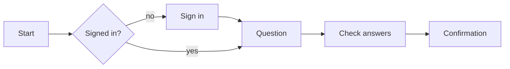

# User flows

The current flow is recorded in `ai-platform-frontend/docs/flat-design-updates/v3/build-plan.md` and the journeys in `ai-platform-discovery-docs/src/content/journey.md`. Read both before changing a step.

## 1. Start from the need

One line: "As a {role, tier}, I need {outcome} so that {reason}." Name the people: Member, Admin, platform admin; research or team tier. Unknown? Ask; do not invent a persona.

## 2. Map the flow

| Step | Route               | Page type (pattern) | Shows | Person does | Next (success) | Other paths                |
| ---- | ------------------- | ------------------- | ----- | ----------- | -------------- | -------------------------- |
| 1    | `/connect/team/...` | Question            | ...   | ...         | step 2         | 403 role, validation error |

Then a small diagram:

## 3. Check the flow

- **Whole problem:** the person can finish without leaving the service or guessing; the next step after "done" is clear.
- **Every branch:** validation error, no permission (hidden or 403 with a way out), not found, upstream failure, slow or pending work (status page with refresh, no raw status names), empty states, signed out mid-journey.
- **Back and change:** back link on question pages; "Change" links from check answers return to check answers.
- **Fewest steps:** one thing per page, but no page without a decision; do not ask what the service already knows.
- **Consistency:** same pattern, words and buttons as existing journeys.
- **Accessibility:** focus lands on the error summary or heading after each step; nothing time-limited without warning.

## 4. Record

Put the table and diagram in `plan.md`. When the flow changes, the Docs agent updates `build-plan.md` in the same branch. A new journey gets a journey test task (`aip-test-journey`).
