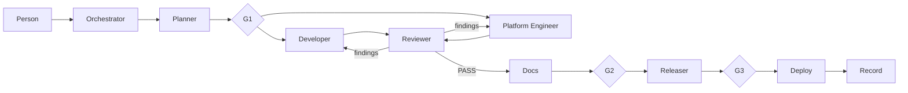

# ai-platform-agents

Copilot agents, skills, prompts and guard hooks that run AI Platform delivery across the `ai-platform-*` repositories: Plan > Design > Build > Review > Docs > Release > Deploy. Thin agents delegate in fresh contexts, deep skills hold the know-how, every claim needs evidence, and each repo's own instructions and the [Defra software development standards](https://github.com/DEFRA/software-development-standards) stay the rules.

## Prerequisites

- VS Code with GitHub Copilot (Local agent harness), Node.js 24 (`.nvmrc`), Git, GitHub CLI (`gh auth login`).
- This repo checked out beside the other `ai-platform-*` repos and opened through `defra-ai-platform.code-workspace` (hooks run `../ai-platform-agents/scripts/aip-guard.mjs`).
- Scanners on PATH for full gates: Snyk CLI (`snyk auth`), gitleaks, Checkov, terraform, tflint, actionlint, shellcheck. Accessibility scans use Playwright from `ai-platform-discovery-docs` (`npm ci` there).

## Set up

1. `npm ci`.
2. Workspace settings (already in the workspace file): `chat.subagents.allowInvocationsFromSubagents: true`, `chat.useHooks: true`; trust the workspace.
3. SonarQube Cloud MCP (approved for this project, read-only): start `sonarqube` in `.vscode/mcp.json` and enter a token when asked. Tokens never go in files.
4. Check the guard: ask **AIP Developer** to run `git push --force`; it must be refused.
5. Set `editor.formatOnSave` to false, or Prettier as the default formatter, for this folder: VS Code's own formatter rewrites files on save.

## Use

Pick **AIP Orchestrator** or type `/aip-start` with a requirement or a link to a plan item, design page, spec or Plan-mode plan. Approve the plan (G1), shipping (G2) and any deploy (G3).

| Prompt             | Does                                                     |
| ------------------ | -------------------------------------------------------- |
| `/aip-start`       | New run through the Orchestrator                         |
| `/aip-resume`      | Continue a run in a fresh chat from its run folder       |
| `/aip-refine-plan` | Turn a Copilot Plan-mode plan into an AIP brief and plan |
| `/aip-review`      | Independent review of current changes, outside a run     |

| Agent                 | Does                                                                        | Model, effort      | Edits                        |
| --------------------- | --------------------------------------------------------------------------- | ------------------ | ---------------------------- |
| AIP Orchestrator      | Intake, questions, routing, evidence checks, gates, summary                 | Opus 5.5, medium   | Nothing                      |
| AIP Planner           | Brief, ACs, user flows, decisions with trade-offs, impact, plan with owners | Opus 5.5, xhigh    | Run folder, plans, discovery |
| AIP Developer         | Frontend, backend, journey tests, this repo: test-first, GDS, accessible    | Sonnet 5.5, high   | App repos                    |
| AIP Platform Engineer | Terraform, workflows, environments: tested offline, never applied by hand   | Sonnet 5.5, high   | Platform repos               |
| AIP Reviewer          | Fresh-context gates, coverage, scans, Sonar, code review, AC proof          | Opus 5.5, medium   | Run folder only              |
| AIP Releaser          | Commits, PRs, Copilot review loop, CI, releases, GitOps applies             | Sonnet 5.5, medium | Run folder only              |
| AIP Docs              | Plans, implemented features, READMEs, discovery built state                 | Sonnet 5.5, medium | Markdown and docs            |

Skills (`.github/skills/aip-*`), grouped:

- **Flow:** `handoff`, `evidence`, `intake`, `plan`, `design`, `change-impact`.
- **Standards:** `defra-standards`, `cdp`, `architecture`, `clean-code`.
- **UI:** `gds-ui`, `user-flows`, `accessibility` (with `axe-scan.mjs`).
- **Build:** `build-node`, `build-terraform`, `build-gitops`.
- **Test and review:** `test-design`, `test-node`, `test-journey`, `quality-gates` (with `run-gates.mjs`), `code-review`, `security-review`, `validate`.
- **Ship:** `pull-request`, `deploy-operate`, `docs`.

Run state lives in `.copilot-tracking/runs/{date}-{slug}/` (git-ignored). The guard hook denies `--no-verify`, force push (including `git -C`), `reset --hard`, local Terraform apply and state changes, PR merges (CLI and MCP), re-runs, `.env` access and hand edits to tenants or deployments state; asks before push, PR, dispatch, Azure writes, recursive deletes and edits to agents, hooks or workspace settings; and limits each agent's edit paths.

## Run the tests

- `npm test`: unit and integration tests with coverage thresholds (lines and functions 90, branches 85).
- `npm run validate`: frontmatter, cross-references, skill names, links and sizes.
- `npm run format:check`; `npm run format` to fix.

## Branching and contributing

Branch from `main` (`feature/`, `fix/`, `docs/`, `chore/`), small focused commits (`type: imperative summary`), pull request, Copilot review, then one human approval. Never `--no-verify`. Authoring rules: [.github/copilot-instructions.md](.github/copilot-instructions.md). Useful patterns go back to [defra-ai-config-examples](https://github.com/DEFRA/defra-ai-config-examples).

## Licence

[Open Government Licence v3](LICENCE).
