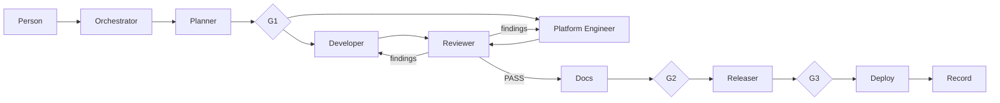

# ai-platform-agents

Copilot agents, skills, prompts and guard hooks that run AI Platform delivery across the `ai-platform-*` repositories: Plan > Design > Build > Review > Docs > Release > Deploy. Thin agents delegate in fresh contexts, deep skills hold the know-how, every claim needs evidence, and each repo's own instructions and the [Defra software development standards](https://github.com/DEFRA/software-development-standards) stay the rules.

## Prerequisites

- VS Code with GitHub Copilot (Local agent harness), Node.js 24 (`.nvmrc`), Git, GitHub CLI (`gh auth login`).
- This repo checked out beside the other `ai-platform-*` repos and opened through `defra-ai-platform.code-workspace` (hooks run `../ai-platform-agents/scripts/aip-guard.mjs`).
- Scanners on PATH for full gates: Snyk CLI (`snyk auth`), gitleaks, Checkov, terraform, tflint, actionlint, shellcheck. Accessibility scans use Playwright from `ai-platform-discovery-docs` (`npm ci` there).

## Set up

1. `npm ci`.
2. Workspace settings (already in the workspace file): `chat.subagents.allowInvocationsFromSubagents: true`, `chat.useHooks: true`; trust the workspace.
3. SonarQube Cloud MCP (approved for this project, read-only): start `sonarqube` in `.vscode/mcp.json` and enter a token when asked. Tokens never go in files.
4. Check the guard: ask **AIP Developer** to run `git push --force`; it must be refused.
5. Set `editor.formatOnSave` to false, or Prettier as the default formatter, for this folder: VS Code's own formatter rewrites files on save.

## Use

Pick **AIP Orchestrator** or type `/aip-start` with a requirement or a link to a plan item, design page, spec or Plan-mode plan. Approve the plan (G1), shipping (G2) and any deploy (G3).

| Prompt             | Does                                                                                      |
| ------------------ | ----------------------------------------------------------------------------------------- |
| `/aip-start`       | New run through the Orchestrator                                                          |
| `/aip-resume`      | Continue a run in a fresh chat from its run folder (`state.md`, live PR state)            |
| `/aip-status`      | Where a run stands now: PR states, waits, parked requests; changes nothing but `state.md` |
| `/aip-refine-plan` | Turn a Copilot Plan-mode plan into an AIP brief and plan                                  |
| `/aip-review`      | Independent review of current changes, outside a run                                      |
| `/hve-create`      | Create an HVE board item from a design PR or an idea                                      |
| `/hve-move`        | Move an HVE board item to another column                                                  |

The two `/hve-` prompts run the [AI Platform HVE Board](https://github.com/orgs/DEFRA/projects/23) by the guide in `ai-platform-discovery-docs` `docs/hve-board.md`, for example `/hve-create https://github.com/DEFRA/ai-platform-discovery-docs/pull/64 ready` or `/hve-move #42 in progress`. They need `gh` signed in with the `project` scope (`gh auth refresh -s project`).

| Agent                         | Does                                                                        | Model, effort      | Edits                        |
| ----------------------------- | --------------------------------------------------------------------------- | ------------------ | ---------------------------- |
| AIP Orchestrator              | Intake, questions, routing, evidence checks, gates, summary                 | Opus 5.5, medium   | Nothing                      |
| AIP Planner                   | Brief, ACs, user flows, decisions with trade-offs, impact, plan with owners | Opus 5.5, xhigh    | Run folder, plans, discovery |
| AIP UX Designer               | Job, journey and page designs as SVG wireframes, with accessibility notes   | Opus 5.5, high     | Run folder only              |
| AIP Developer                 | Frontend, backend, journey tests, this repo: test-first, GDS, accessible    | Sonnet 5.5, high   | App repos                    |
| AIP Platform Engineer         | Terraform, workflows, environments: tested offline, never applied by hand   | Sonnet 5.5, high   | Platform repos               |
| AIP Reviewer                  | Fresh-context gates, coverage, scans, Sonar, code review, AC proof          | Opus 5.5, medium   | Run folder only              |
| AIP Releaser                  | Commits, PRs, Copilot review loop, CI, releases, GitOps applies             | Sonnet 5.5, medium | Run folder only              |
| AIP Docs                      | Plans, implemented features, READMEs, discovery built state                 | Sonnet 5.5, medium | Markdown and docs            |
| AIP Direct Fullstack Engineer | You pick it in chat to work directly, no orchestration; any repo            | Your chat model    | Any repo, as you ask         |



For work without the Orchestrator, see [Work directly with AIP Direct Fullstack Engineer](#work-directly-with-aip-direct-fullstack-engineer).

Skills (`.github/skills/aip-*`), grouped:

- **Flow:** `handoff`, `run-control`, `evidence`, `intake`, `plan`, `design`, `change-impact`.
- **Standards:** `defra-standards`, `cdp`, `architecture`, `clean-code`.
- **UI:** `gds-ui`, `user-flows`, `accessibility` (with `axe-scan.mjs`).
- **Build:** `build-node`, `build-terraform`, `build-gitops`.
- **Test and review:** `test-design`, `test-node`, `test-journey`, `quality-gates` (with `run-gates.mjs`), `code-review`, `security-review`, `validate`.
- **Ship:** `pull-request` (with `pr-state.mjs`), `deploy-operate`, `docs`.

Cost, time and control: `aip-run-control` ends every loop in a named state (a PR is `SETTLED`, not "probably done"), checks freshness by commit rather than clock, parks waits instead of polling (the 7-day package-age rule: `min-release-age=7` in `.npmrc` makes npm refuse versions published in the last 7 days), and keeps a one-screen `state.md` so a fresh chat can continue without being handed context. `run-gates.mjs` skips code suites for docs-only changes and reuses a green run of an identical tree (`--reuse`).

To stop a mid-run message cancelling running subagents, send it with **Add to Queue** from the Send menu, or set `chat.requestQueuing.defaultAction` to `queue` in your user settings.

Run state lives in `.copilot-tracking/runs/{date}-{slug}/` (git-ignored). The guard hook denies `--no-verify`, force push (including `git -C`), `reset --hard`, local Terraform apply and state changes, PR merges (CLI and MCP), re-runs, `.env` access and hand edits to tenants or deployments state; asks before push, PR, dispatch, Azure writes, recursive deletes and edits to agents, hooks or workspace settings; and limits each agent's edit paths.

## Work directly with AIP Direct Fullstack Engineer

[`aip-direct-fullstack-engineer.agent.md`](.github/agents/aip-direct-fullstack-engineer.agent.md) is for when you want to drive the work yourself, with no autonomous orchestration. It can do any work in any `ai-platform-*` repo: plan, design, build, test, review, fix, document or operate.

- **Human-picked only.** AIP Orchestrator and the other AIP agents never use it (it is not in the Orchestrator allow-list and sets `disable-model-invocation: true`).
- **One copy.** It lives here only. The frontend and backend repos no longer carry their own.
- **Names the repo first.** It states which repo or repos the task touches, then reads that repo's `.github/copilot-instructions.md`, the matching file in its `.github/instructions/`, and that repo's own AICE skills. The frontend and backend keep different copies of `javascript-style-guide`, `javascript-testing-standards` and `javascript-review-standards`, so it reads the ones from the repo being edited.
- **Cross-repo work.** It reads both repos' files and keeps the frontend `api-client.js` calls in step with the backend routes and `code`-based errors.
- **Asks first.** It asks before any push, pull request or deploy.

Use it in VS Code:

1. Open `defra-ai-platform.code-workspace` so `ai-platform-agents` and the repos you want to change are all open.
2. In Chat, choose **AIP Direct Fullstack Engineer** in the agent picker.
3. Say what you want, and the repo if it is not obvious, for example `In the backend, add a POST /api/v1/widgets route with validation`. If it picks the wrong repo, name it or open a file from the right one.

Use it in the Copilot CLI:

```
copilot --agent aip-direct-fullstack-engineer --add-dir ../ai-platform-frontend --add-dir ../ai-platform-backend-api
```

It is only listed while this repo is in the workspace (or its folder is added in the CLI). Use AIP Orchestrator instead when a change needs a plan, independent review, a PR and a release.

## Run the tests

- `npm test`: unit and integration tests with coverage thresholds (lines and functions 90, branches 85).
- `npm run validate`: frontmatter, cross-references, skill names, links and sizes.
- `node scripts/check-message-text.mjs --file <path>`: lints commit or PR text for the [plain-text rule](.github/skills/aip-pull-request/SKILL.md#plain-text-messages).
- `npm run format:check`; `npm run format` to fix.

## Branching and contributing

Branch from `main` (`feature/`, `fix/`, `docs/`, `chore/`), small focused commits (`type: imperative summary`), pull request, Copilot review, then one human approval. Never `--no-verify`. Authoring rules: [.github/copilot-instructions.md](.github/copilot-instructions.md). Useful patterns go back to [defra-ai-config-examples](https://github.com/DEFRA/defra-ai-config-examples).

## Licence

[Open Government Licence v3](LICENCE).
